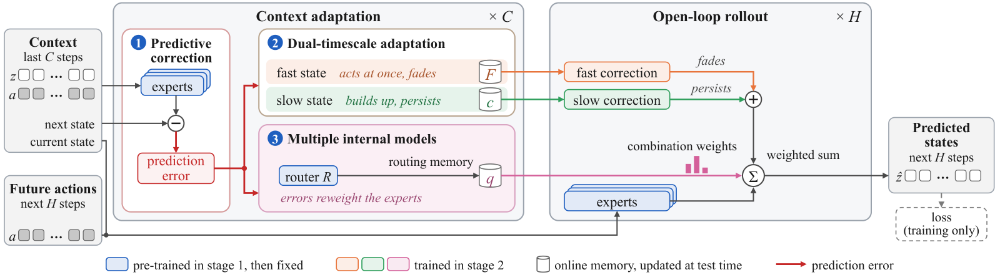
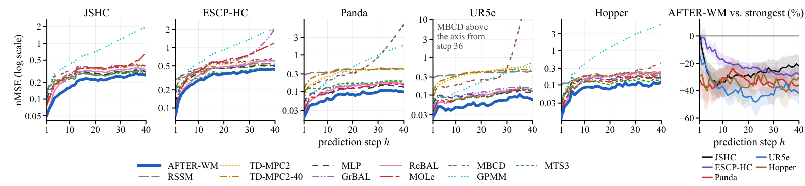
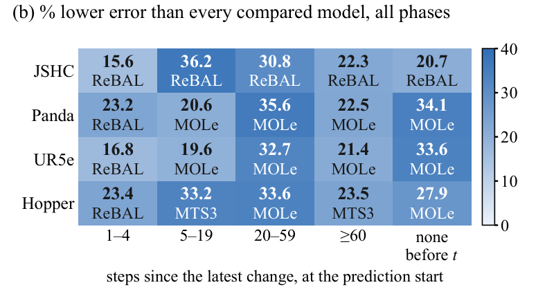
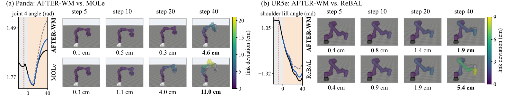
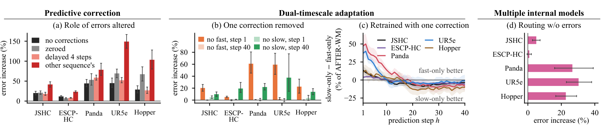
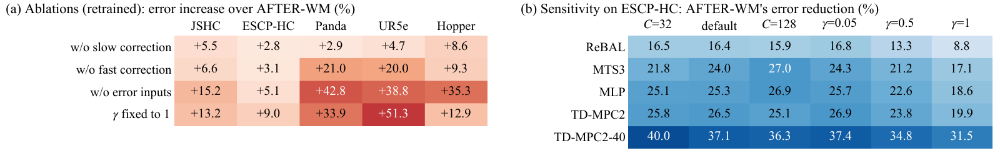

<div align="center">

# AFTER

### A World Model with Adaptive Fast–Slow Timescales<br>for Error-Driven Retention

**Anonymous authors**

**English | [简体中文](README_zh.md)**

**[Quick start](#quick-start)** · **[Datasets](#datasets)** · **[Results](#main-results)**

</div>

**AFTER-WM is a world model with Adaptive Fast–slow Timescales for Error-driven Retention.** Inspired by predictive coding in the human brain with multi-timescale adaptation, its prediction errors drive a fast correction that fades and a slow correction that persists, while dynamically adjusting the combination weights of pre-trained experts without altering them, to overcome the trade-offs among responsiveness, stability and persistence.

This repository accompanies the paper **AFTER: A World Model with Adaptive Fast–Slow Timescales for Error-Driven Retention**. It contains the code of AFTER-WM (`afterwm/`), the ten compared models (`baselines/`), the shared training and evaluation pipeline (`pipeline/`), the dataset generators and the six datasets (`datasets/`, `data/`), the statistics and figure code (`afterwm_stats/`, `figures/`), the stored evaluation outputs (`outputs/`) and the entry scripts (`experiments/`). The table 'Paper items and their scripts' maps each reproduced table and figure to its script.

## Overview

A world model predicts how a robot's state responds to actions, for planning and control. In robotics and embodied AI, a core challenge for world models is adapting to sudden, persistent, yet initially unknown changes in robot dynamics during interaction. For instance, when a robotic arm grasps an object with an unknown payload, the robot dynamics change suddenly. If the world model fails to adapt, its prediction errors accumulate over the open-loop rollout and ultimately mislead the robot's actions.

Existing world models, however, struggle to simultaneously satisfy three critical requirements for dynamics adaptation:

- **Responsiveness**: reacting promptly to sudden changes to curb prediction error accumulation.
- **Stability**: distinguishing persistent changes from transient disturbances to prevent incorrect updates.
- **Persistence**: retaining the adapted dynamics without new observations so that later predictions do not revert to the old dynamics.

Satisfying all three at once is hard. The faster adaptation reacts, the more easily a transient disturbance misleads it, and adaptation that fades quickly enough to drop a transient disturbance cannot persist.

The three designs of AFTER-WM, predictive correction, dual-timescale adaptation and multiple internal models, are all driven by the same prediction errors and together aim at dynamics adaptation with responsiveness, stability and persistence:

1. **Predictive correction** mainly serves responsiveness. Pre-trained dynamics models, called experts, act as internal models, and their one-step prediction errors update online memories at each observed step without gradients.
2. **Dual-timescale adaptation** mainly serves stability and persistence. Its fast correction acts at once and fades, while its slow correction builds up and persists.
3. **Multiple internal models** mainly serve persistence. Prediction errors adjust the combination weights via a routing memory and never alter the experts.



*Architecture of AFTER-WM (Fig. 2 of the paper). Inputs are on the left, predicted states on the right. In context adaptation, for each context step (×C), module 1 computes the experts' prediction errors (red arrows). They update the online memories (cylinders) in modules 2 and 3. In the open-loop rollout, for each predicted step (×H), the experts' predictions get the orange fast and green slow corrections and are summed with the pink routing memory's combination weights. Blue blocks are pre-trained, then fixed; orange, green and pink ones are trained in stage 2. The dashed loss is only for training.*

At test time, only the online memories change: the routing memory and, per expert, a fast state and a slow state. They come from the context, not from training, so adapting needs no gradient update. In the open-loop rollout, without new observations, the routing memory and the slow state stay fixed, the fast state only fades, and the combination weights are computed once.

**Task and metrics.** All models use the same context of C = 64 steps and horizon of H = 40 steps (2 s). Given the same context and the actions recorded for the 40 predicted steps, every model predicts only the 40 states. Errors are measured on states, not images. The per-step error (nMSE) is the mean squared error at one predicted step, with each state dimension standardized on the training set. The main measure, the multi-step mean error, takes the mean per-step error over steps 1 to n and averages it over n ∈ {1, 5, 10, 20, 40}, so short and long horizons both count. The step-40 error is the per-step error at the last step. A query, also called a window or a test sample, consists of a 64-step context and the 40 following actions and states.

## Quick start

The quick start needs a CPU only. It needs no GPU, no checkpoint and no download besides this repository: the six datasets and the stored outputs are included.

1. **Get the repository.** Download this repository, unzip it and open a terminal in its folder.

2. **Install the figures environment** (Python 3.11; numpy, matplotlib and Pillow only).

   ```
   python3.11 -m venv venv-figures && venv-figures/bin/pip install -r environment/requirements-figures.txt
   ```

3. **Check the data and recompute the results.**

   ```
   venv-figures/bin/python datasets/check_data.py --data data
   PYTHON=venv-figures/bin/python bash experiments/all_from_outputs.sh
   venv-figures/bin/python scripts/verify_release.py --results results
   ```

The first command compares every array of `data/` with the recorded checksums. The second reads `outputs/` and writes `results/`; it takes about 30 s and has succeeded when the last line printed is `done: results written to results`. The third compares the data files, the stored outputs, the values of Table 1 and nine numbers of the text with the recorded values and prints `"passed": true`. The same three commands are run automatically by `.github/workflows/reproduce.yml` whenever the repository is updated.

| Written file | Content |
|---|---|
| `results/tables/table1.tex` | Table 1 |
| `results/tables/table2.tex` | Table 2 |
| `results/figures/` | Fig. 1b, 3, 4, 6 and 7 as PDF and PNG, with the plotted values as JSON |
| `results/paper_numbers.json` | the numbers of the text that this repository reproduces, key by key (see `docs/RESULTS_MAP.md`) |
| other `results/*.json` files | per-step errors, change phases, queries without a change, tests of the three designs, probes, sensitivity and control |

To recompute a single item, run its script in `experiments/` (see the table 'Paper items and their scripts').

## Main results

The numbers of this section are recomputed from the stored outputs by `experiments/all_from_outputs.sh` (see Quick start).

### Main results on the five simulated datasets (Table 1)

Reliable planning needs accurate predictions over many steps, so we compare the multi-step mean and step-40 errors of all models on the five simulated datasets. The table gives the multi-step mean error (nMSE, lower is better) as the mean ± standard deviation over 5 seeds. On each dataset, the strongest compared model is the one with the lowest multi-step mean error. It is ReBAL or MOLe, both online-adaptive.

| Dataset | AFTER-WM | Strongest compared model | AFTER-WM vs. strongest |
|---|---|---|---|
| JSHC | **0.124 ± 0.001** | ReBAL, 0.166 ± 0.007 | 25.7% lower, in 5 of 5 seeds |
| ESCP-HC | **0.208 ± 0.003** | ReBAL, 0.249 ± 0.004 | 16.4% lower, in 5 of 5 seeds |
| Panda | **0.0473 ± 0.0007** | MOLe, 0.0711 ± 0.0013 | 33.5% lower, in 5 of 5 seeds |
| UR5e | **0.0435 ± 0.0014** | ReBAL, 0.0641 ± 0.0035 | 32.1% lower, in 5 of 5 seeds |
| Hopper | **0.0499 ± 0.0027** | MOLe, 0.0752 ± 0.0024 | 33.7% lower, in 5 of 5 seeds |

AFTER-WM is best on both errors on all five datasets. Its multi-step mean error is lower than every compared model's in all 5 seeds, and all 50 differences have 95% intervals below zero. It is 16.4%–33.7% lower than the strongest compared model's. So in simulation, AFTER-WM is best over many steps.

<details>
<summary><b>All eleven models: multi-step mean error</b> (click to open)</summary>

| Model | JSHC | ESCP-HC | Panda | UR5e | Hopper |
|---|---|---|---|---|---|
| DreamerV3-style RSSM | 0.197 ± 0.003 | 0.372 ± 0.006 | 0.329 ± 0.016 | 0.331 ± 0.011 | 0.145 ± 0.003 |
| TD-MPC2 | 0.192 ± 0.002 | 0.284 ± 0.008 | 0.189 ± 0.013 | 0.226 ± 0.014 | 0.102 ± 0.004 |
| TD-MPC2-40 | 0.212 ± 0.002 | 0.332 ± 0.002 | 0.244 ± 0.007 | 0.253 ± 0.010 | 0.111 ± 0.002 |
| MLP | 0.195 ± 0.001 | 0.279 ± 0.002 | 0.0841 ± 0.0024 | 0.0846 ± 0.0035 | 0.0953 ± 0.0011 |
| GrBAL | 0.210 ± 0.006 | 0.352 ± 0.087 | 0.0889 ± 0.0040 | 0.0836 ± 0.0034 | 0.0817 ± 0.0040 |
| ReBAL | 0.166 ± 0.007 | 0.249 ± 0.004 | 0.0728 ± 0.0017 | 0.0641 ± 0.0035 | 0.0867 ± 0.0126 |
| MOLe | 0.204 ± 0.010 | 0.320 ± 0.021 | 0.0711 ± 0.0013 | 0.0665 ± 0.0012 | 0.0752 ± 0.0024 |
| MBCD | 0.245 ± 0.006 | 0.365 ± 0.024 | 0.318 ± 0.412 | 1.951 ± 3.957 | 0.111 ± 0.021 |
| GPMM | 0.395 ± 0.077 | 0.496 ± 0.021 | 0.216 ± 0.103 | 0.124 ± 0.071 | 0.535 ± 0.396 |
| MTS3 | 0.208 ± 0.001 | 0.274 ± 0.004 | 0.126 ± 0.003 | 0.0861 ± 0.0031 | 0.0796 ± 0.0020 |
| **AFTER-WM** | **0.124 ± 0.001** | **0.208 ± 0.003** | **0.0473 ± 0.0007** | **0.0435 ± 0.0014** | **0.0499 ± 0.0027** |

</details>

<details>
<summary><b>All eleven models: step-40 error</b> (click to open)</summary>

| Model | JSHC | ESCP-HC | Panda | UR5e | Hopper |
|---|---|---|---|---|---|
| DreamerV3-style RSSM | 0.311 ± 0.004 | 0.532 ± 0.009 | 0.404 ± 0.022 | 0.418 ± 0.013 | 0.224 ± 0.009 |
| TD-MPC2 | 0.370 ± 0.012 | 0.599 ± 0.033 | 0.411 ± 0.026 | 0.547 ± 0.064 | 0.204 ± 0.010 |
| TD-MPC2-40 | 0.279 ± 0.009 | 0.499 ± 0.012 | 0.409 ± 0.010 | 0.450 ± 0.022 | 0.219 ± 0.013 |
| MLP | 0.306 ± 0.009 | 0.486 ± 0.009 | 0.130 ± 0.007 | 0.116 ± 0.003 | 0.177 ± 0.004 |
| GrBAL | 0.402 ± 0.021 | 2.119 ± 3.354 | 0.176 ± 0.009 | 0.145 ± 0.006 | 0.203 ± 0.032 |
| ReBAL | 0.341 ± 0.008 | 0.596 ± 0.029 | 0.162 ± 0.011 | 0.130 ± 0.018 | 0.247 ± 0.029 |
| MOLe | 0.726 ± 0.723 | 1.222 ± 0.607 | 0.149 ± 0.007 | 0.123 ± 0.005 | 0.178 ± 0.012 |
| MBCD | 0.388 ± 0.022 | 0.641 ± 0.034 | 6.801 ± 14.710 | 172.477 ± 384.954 | 0.434 ± 0.480 |
| GPMM | 1.944 ± 0.928 | 2.065 ± 0.153 | 1.815 ± 1.153 | 0.717 ± 0.945 | 5.595 ± 4.130 |
| MTS3 | 0.290 ± 0.004 | 0.441 ± 0.002 | 0.190 ± 0.011 | 0.133 ± 0.006 | 0.157 ± 0.004 |
| **AFTER-WM** | **0.266 ± 0.008** | **0.428 ± 0.008** | **0.0956 ± 0.0021** | **0.0753 ± 0.0037** | **0.124 ± 0.003** |

</details>

On Panda and UR5e, one MBCD seed's predictions diverge.

### Per-step errors (Fig. 3)



*Fig. 3 of the paper. Per-step error of all models on the five simulated datasets (left); AFTER-WM vs. the strongest compared model (right).*

An average can hide weak steps, and adaptation must persist over the whole horizon, so we also compare the errors at each of the 40 predicted steps. AFTER-WM, the thick blue line, has the lowest error at every step from step 2 on, on every simulated dataset. The right plot shows, in percent, how much AFTER-WM's per-step error differs from the strongest compared model's, one colored line per dataset. Below zero, AFTER-WM is better. From step 4 on, all intervals lie below zero, and at step 40 its error is 21.9%–41.9% lower. So it still leads at the last step.

### Change phases (Fig. 1b)



*Fig. 1b of the paper. AFTER-WM's error reduction over the closest compared model.*

An average cannot show responsiveness, stability and persistence. So we sort the test samples into five phases by the time from the latest change to the prediction start, and compare all models in each phase. Each row is a dataset and each column a phase. A cell's bold number is how much lower AFTER-WM's multi-step mean error is than that of the closest compared model, named below it. A darker blue means a larger gap. All cells are positive, so AFTER-WM beats all ten in every phase, also on ESCP-HC, not shown since its phases differ. Even 1–4 steps after a change, it is at least 15.6% lower. With no change in the context or horizon, it is at least 6.6% lower. If these samples have transient disturbances, which test stability, it is at least 28.1% lower on Panda, UR5e and Hopper. So in simulation, AFTER-WM is the most accurate whether a change is recent, ongoing or absent.

### Robot-arm examples (Fig. 4)



*Fig. 4 of the paper. Joint angles predicted by AFTER-WM and the strongest compared model, drawn as arm poses and starting 8 steps after a change.*

The Panda arm picks up about 1.4 kg as its joint friction changes, and the UR5e puts down its payload as friction and motor strength return to normal. The images show the poses at steps 5, 10, 20 and 40, AFTER-WM on top, the compared model below and the true pose in gray. Each predicted link is colored by its link deviation, the distance from the truth, in centimeters. The number below is the mean over the links, in bold at step 40. There, AFTER-WM is off by 4.6 cm on Panda and 1.9 cm on UR5e, less than half of MOLe's 11.0 cm and ReBAL's 5.4 cm.

### Generalization and control (Table 2)

Further tests: compared models beaten by AFTER-WM and its smallest margin.

| Setting | Compared models beaten | Smallest margin (closest model) |
|---|---|---|
| Beyond training (ESCP-HC) | 10 of 10 | 5.9% (ReBAL) |
| No change (5 datasets) | 10 of 10 | 6.6% (ReBAL) |
| Real flights (ALFA) | 10 of 10 | 13.1% (MOLe) |
| Control (JSHC) | 10 of 10 | +13.8 (MOLe) |

- **Beyond the training range.** Changes in deployment may exceed those seen in training. On ESCP-HC, AFTER-WM beats all ten, by at least 5.9% in multi-step mean error.
- **Real flight data.** Simulation may miss some real changes, so we also test on ALFA, with the same setting and 4 seeds shared by all models. On ALFA, AFTER-WM's multi-step mean error is at least 13.1% below each compared model's and lower in all 4 seeds.
- **Control.** World models serve planning, so we test if higher accuracy raises the return, the total reward, in GrBAL's joint-failure task on JSHC (5 seeds, 48 test episodes). All models use the same cross-entropy-method planner, so return differences come from the world models. AFTER-WM, the most accurate model, also has the highest mean return, 93.1, which is 13.8 above the second best, MOLe.

### What each design does (Fig. 6)



*Fig. 6 of the paper. Tests of the three designs: alterations at test time in (a), (b) and (d), and retrained models in (c). On UR5e, (b) and (d) use 4 seeds.*

- **Predictive correction.** This design means that AFTER-WM relies on the current sequence's prediction errors. At test time, we remove both corrections, zero the errors, delay them by 4 steps or use another sequence's. All four alterations raise the multi-step mean error on every dataset, the last one most, by 23.3%–149.0%. So the content of the errors matters, not just their statistics.
- **Dual-timescale adaptation.** This design means that the fast correction mainly serves early steps and the slow one late steps. Without the fast correction, the step-1 error rises by 5.2%–60.9%. Without the slow one, the step-40 error rises by 9.9%–37.6%. But the errors at the other step change by at most 4.9%.
- **Multiple internal models.** This design means that reweighting the fixed experts by their errors helps prediction. When the errors no longer update the routing memory at test time, the error increases are 5.1%–30.3%, and 0.9% on ESCP-HC. So reweighting helps.

### Ablations and hyperparameter sensitivity (Fig. 7)



*Fig. 7 of the paper. Multi-step mean error. (a) Ablations, retrained at about 0.70M parameters. (b) Sensitivity to C and γ on ESCP-HC.*

- **Ablations.** To see if each part matters beyond size, we remove one at a time and retrain at about 0.70M parameters. Every removal raises the multi-step mean error on every dataset, by 2.8%–51.3%. So both corrections, the error inputs and the more even combination weights all help here.
- **Hyperparameter sensitivity.** On ESCP-HC, in the 25 cells with a changed setting, AFTER-WM wins in all 5 seeds, by 8.8%–40.0%. So on ESCP-HC, it leads in every setting tested.

## Datasets

We use six datasets: five simulated in MuJoCo and one of real flights. Two established datasets follow earlier work. In Joint-Switch HalfCheetah (JSHC), as in GrBAL and MBCD, a random leg joint loses power every 100 steps. In ESCP-HC, as in ESCP, gravity, joint damping and torso mass are scaled by new random factors every 100 steps. Three new datasets on standard robot models add robot arms and more kinds of change. On the Panda and UR5e arms, the payload, joint friction and motor strength change, and on Hopper the torso mass, ground friction and motor strength. A change happens once or several times, may go back or drift slowly, and transient disturbances such as pulses and impacts occur in between. The real data are public fixed-wing UAV flights with engine or control-surface faults from ALFA. All data files are in `data/`.

| Dataset | What changes | State / action dimensions | Sequences per split | Size of the data folder (MB) | Card |
|---|---|---|---|---|---|
| JSHC | a random leg joint loses power every 100 steps | 17 / 6 | 288 / 144 / 144 / 144 | 14.0 | [jshc.md](datasets/cards/jshc.md) |
| ESCP-HC | gravity, joint damping and torso mass are scaled by new random factors every 100 steps | 17 / 6 | 288 / 144 / 144 / 144 | 24.2 | [escphc.md](datasets/cards/escphc.md) |
| Panda | the payload, joint friction and motor strength of the arm | 14 / 7 | 288 / 144 / 144 / 144 | 8.5 | [panda.md](datasets/cards/panda.md) |
| UR5e | the payload, joint friction and motor strength of the arm | 12 / 6 | 288 / 144 / 144 / 144 | 7.2 | [ur5e.md](datasets/cards/ur5e.md) |
| Hopper | the torso mass, ground friction and motor strength | 11 / 3 | 288 / 144 / 144 / 144 | 6.4 | [hopper.md](datasets/cards/hopper.md) |
| ALFA | real fixed-wing UAV flights with engine or control-surface faults | 12 / 3 | 240 / 86 / 100 / 122 | 10.6 | [alfa.md](datasets/cards/alfa.md) |

The splits are TRAIN / VAL / TEST / TEST_B (the paper's TE-B); the paper uses TEST and TEST_B together as the test set. A size is the sum of the four files of a folder, in units of 1,000,000 bytes.

- **Format.** Each file is a NumPy `.npz` archive. Every sequence has 301 states and 300 transitions at 0.05 s per step. The array `obs` holds the states and `act` the actions, both as float32. Physical parameters and change labels are stored for analysis only; they are not inputs of any model.
- **Two more folders** are used for evaluation only: `data/escphc_beyond/` (ESCP-HC test files beyond the training range) and `data/control_episodes/` (start conditions of the control task).
- **Documentation.** The datasheet is [data/README.md](data/README.md) (composition, collection, splits, labels, licences, checksums). Each dataset has a card in `datasets/cards/`. The overview and the commands are in [docs/DATASETS.md](docs/DATASETS.md).
- **Regeneration.** The generators of the five simulated datasets and the processing script of ALFA are in `datasets/`; `docs/DATASETS.md` gives the commands and the pinned environment.

Loading one file and cutting one query (run from the repository root):

```python
import numpy as np

train = np.load("data/panda/panda_train.npz", allow_pickle=False)
test = np.load("data/panda/panda_test.npz", allow_pickle=False)
obs, act = test["obs"], test["act"]
print(obs.shape, act.shape)
flat_obs = train["obs"].reshape(-1, obs.shape[-1]).astype(np.float64)
flat_act = train["act"].reshape(-1, act.shape[-1]).astype(np.float64)
obs_mean, obs_std = flat_obs.mean(0), np.maximum(flat_obs.std(0), 1e-6)
act_mean, act_std = flat_act.mean(0), np.maximum(flat_act.std(0), 1e-6)
sequence, start, context, horizon = 0, 64, 64, 40
ctx_obs = (obs[sequence, start - context:start + 1] - obs_mean) / obs_std
ctx_act = (act[sequence, start - context:start] - act_mean) / act_std
fut_act = (act[sequence, start:start + horizon] - act_mean) / act_std
fut_obs = (obs[sequence, start + 1:start + horizon + 1] - obs_mean) / obs_std
print(ctx_obs.shape, ctx_act.shape, fut_act.shape, fut_obs.shape)
```

## Training and evaluation

### Compared models

We compare AFTER-WM with ten models from three classes. The general-purpose models are the recurrent state-space model (RSSM) of DreamerV3, TD-MPC2, TD-MPC2-40 trained with a 40-step loss, and an MLP. The online-adaptive models are GrBAL and ReBAL, MOLe, MBCD and GPMM, and the multi-timescale model is MTS3. All neural models, including AFTER-WM, have about 0.70M parameters (GPMM is non-parametric), so size cannot explain the differences. All models use the same training and test pipeline, data splits, context of C = 64 steps and horizon of H = 40 steps (2 s). All settings are chosen without the test data, and AFTER-WM uses K = 3 experts.

| Class | Model | Code |
|---|---|---|
| General-purpose | DreamerV3-style RSSM | `baselines/rssm.py` |
| General-purpose | TD-MPC2 | `baselines/tdmpc2.py` |
| General-purpose | TD-MPC2-40 (trained with a 40-step loss) | `baselines/tdmpc2_h40.py` |
| General-purpose | MLP | `baselines/mlp.py` |
| Online-adaptive | GrBAL | `baselines/grbal.py` |
| Online-adaptive | ReBAL | `baselines/rebal.py` |
| Online-adaptive | MOLe | `baselines/mole.py` |
| Online-adaptive | MBCD | `baselines/mbcd.py` |
| Online-adaptive | GPMM | `baselines/gpmm.py` |
| Multi-timescale | MTS3 | `baselines/mts3.py` |

The sources and licences of the original methods are listed in `THIRD_PARTY_NOTICES.md`.

### Training AFTER-WM

AFTER-WM is trained in two stages.

- **Stage 1: pre-training the base.** The experts and the router are trained together on short training segments. Each expert's training signal depends on its accuracy, so no change labels are needed. Stage 2 then only adds to the frozen base.
- **Stage 2: training the memory networks.** The memory networks are trained the way they run at test time. Each sample resets the memories, reads C context steps and predicts H steps open loop. Gradients flow through the whole context, so the model learns to read changes from errors. The loss covers only the horizon.

The commands for both stages, for the selection steps on validation data, for the ablations, for the ten compared models and for the sensitivity settings are in `docs/REPRODUCE.md`. The configuration of every model on every dataset is in `configs/models/`, and the recorded selection results are in `configs/selection/`.

### Three modes

Every entry script accepts one of three modes.

- `--from-outputs` (default, CPU only, about 30 s for `experiments/all_from_outputs.sh`). Recomputes the results listed in the table 'Paper items and their scripts' from the stored outputs. For these results the stored outputs are the reference.
- `--from-checkpoints` (GPU). For runs that you trained and kept. Put the runs under a runs root (`AFTERWM_RUNS_ROOT`) and run `bash experiments/regenerate_outputs.sh`: it evaluates every run there that has a `best.pt`, runs the GPU analyses and writes the per-query, per-step, analysis, control and label outputs (a full rebuild needs the runs of all models). `outputs/examples/` is not rebuilt by this script: copy it into the regenerated folder, or rebuild it as described in `docs/REPRODUCE.md`. Then run the entry scripts with `AFTERWM_OUTPUTS` set to the regenerated folder.
- `--from-scratch` (GPU). First train everything (stage 1, the selection steps, all models and the sensitivity settings) as described in `docs/REPRODUCE.md`, then continue as in `--from-checkpoints`.

With `--from-checkpoints` or `--from-scratch`, an entry script first names the GPU step it needs; run that step as described in `docs/REPRODUCE.md`.

## Paper items and their scripts

| Paper item | Script | What it writes |
|---|---|---|
| Table 1 | `experiments/table1_main.sh` | the numbers equal Table 1 of the paper |
| Table 2 | `experiments/table2_beyond_range.sh`, `table2_no_change.sh`, `table2_alfa.sh`, `table2_control.sh` | the four rows of Table 2; the table itself is written by `experiments/all_from_outputs.sh` |
| Fig. 1b | `experiments/fig1b_change_phases.sh` | the error reduction by change phase |
| Fig. 3 | `experiments/fig3_per_step.sh` | the per-step errors |
| Fig. 4 | `experiments/fig4_robot_arm_examples.sh` | arm poses at steps 5, 10, 20, 40 with the link deviations |
| Fig. 6 | `experiments/fig6a_errors_altered.sh`, `fig6b_one_correction_removed.sh`, `fig6c_retrained_one_correction.sh` (draws the figure), `fig6d_routing_without_errors.sh` | the tests of the three designs |
| Fig. 7 | `experiments/fig7a_ablations.sh`, `fig7b_sensitivity.sh` (draws the figure) | ablations and hyperparameter sensitivity |
| Numbers in the text of Sec. 4.2, 4.4, 4.5, 4.6 and the 16%–34% of the abstract | `experiments/all_from_outputs.sh` → `results/paper_numbers.json` | queries without a change and with transient disturbances: `experiments/sec42_windows.sh` |
| Supplementary text numbers that follow from the same stored outputs (per-step comparisons, change phases, alterations, removal by phase, models retrained with one correction, linear probes, control) | `experiments/all_from_outputs.sh`, `experiments/supp_e3_probes.sh` | listed key by key in `docs/RESULTS_MAP.md` |

## Where things are in the code

| Paper | Code (file: function or class) |
|---|---|
| Sec. 3.2, the memories are reset before each prediction | `afterwm/model.py`: `AfterWMModel.init_state` |
| Sec. 3.2 to 3.4, one context step: prediction errors, then the updates of the three memories | `afterwm/model.py`: `AfterWMModel.observe_fast` |
| Eq. 1, one-step prediction of each expert with the fast correction | `afterwm/core.py`: `FastPath.expert_zhat`; `afterwm/core.py`: `FastPath.experts_zhat` |
| Eq. 2, fast-state update | `afterwm/core.py`: `FastPath.fast_update` |
| Eq. 3, slow-state update | `afterwm/model.py`: `AfterWMModel.observe_fast` |
| Eq. 4, combination weights | `afterwm/core.py`: `FastPath.route` |
| Eq. 5, routing-memory update | `afterwm/core.py`: `FastPath.fast_update` |
| Eq. 6, open-loop rollout of each expert | `afterwm/model.py`: `AfterWMModel.predict_fast`; `afterwm/core.py`: `MemoryModel.rollout_fast` |
| Sec. 3.5, weighted sum of the experts' predicted states | `afterwm/core.py`: `MemoryForecaster.forecast` |
| Eq. 7, stage-1 loss | `afterwm/lib/experts/train/train_1a.py`: `compute_stage1a_loss`; `afterwm/stage1.py`: `_train_config` |
| Eq. 8, stage-2 loss | `afterwm/core.py`: `strict_loss`; `afterwm/core.py`: `MemoryModel.train_loss` |
| Sec. 3.2, the pre-trained base (router and experts) | `afterwm/lib/experts/models/stage1a.py`: `Stage1ABaseWorldModel` |
| Sec. 3.3, measurement, filter and slow readout networks | `afterwm/lib/memory/networks.py`: `AfterWMNativeDifferentiable` |
| Sec. 3.6, stage 1: pre-training the base | `afterwm/stage1.py`: `main` |
| Sec. 3.6, stage 2: loading the pre-trained base and building the model | `afterwm/base.py`: `build_fast_parent`; `afterwm/model.py`: `build` |

## Repository layout

| Folder | Content |
|---|---|
| `afterwm/` | the method: stage 1 (`afterwm/stage1.py`), the full model (`afterwm/model.py`) and the ablations |
| `pipeline/` | shared training, evaluation and scoring pipeline used by every model; dataset registry |
| `baselines/` | the ten compared models |
| `selection/` | the selections made on validation data (inverse routing temperature γ, GrBAL step size, RSSM evaluation mode) and the epoch rule of stage 1 |
| `configs/` | the configuration of every model on every dataset, the recorded selection results and the sensitivity settings |
| `datasets/`, `data/` | generators, label rules, dataset cards (`datasets/cards/`), the data files and their datasheet (`data/README.md`) |
| `analysis/`, `control/` | tests of the three designs, robot-arm examples, queries without a change; the closed-loop control task |
| `afterwm_stats/` | bootstrap statistics and aggregation of the stored outputs |
| `figures/` | tables and figures |
| `outputs/` | stored evaluation outputs (`outputs/MANIFEST.json`) |
| `experiments/` | entry scripts of the reproduced paper items, `experiments/all_from_outputs.sh`, `experiments/regenerate_outputs.sh` and the shared settings `experiments/env.sh` |
| `environment/` | pinned package versions |
| `scripts/` | `scripts/verify_release.py`, the check of a finished run against the recorded values |
| `docs/` | `docs/REPRODUCE.md`, `docs/RESULTS_MAP.md`, `docs/DATASETS.md`, `docs/FIXED_IDENTIFIERS.md` and the project page |

## Install

Python 3.11 (training, evaluation and dataset generation were run on Linux). Three environments keep the pinned versions apart:

```
python3.11 -m venv venv-figures && venv-figures/bin/pip install -r environment/requirements-figures.txt
python3.11 -m venv venv-train   && venv-train/bin/pip install -r environment/requirements-train.txt
python3.11 -m venv venv-generate && venv-generate/bin/pip install -r environment/requirements-generate.txt
```

- `environment/requirements-figures.txt`: everything needed for `--from-outputs` (numpy, matplotlib, Pillow).
- `environment/requirements-train.txt`: PyTorch 2.5.1 with CUDA 12.4, for training, evaluation and the GPU analyses.
- `environment/requirements-generate.txt`: numpy 2.1.2, MuJoCo 3.11.0 and Gymnasium 1.3.0, for regenerating the simulated datasets.

`environment/requirements-train.txt` and `environment/requirements-generate.txt` list the package versions of the environments that produced the results.

Select the interpreter with `PYTHON`, for example `PYTHON=venv-figures/bin/python bash experiments/all_from_outputs.sh`. To call modules by hand, run from the repository root with `export PYTHONPATH=$PWD:$PWD/datasets`.

MTS3 runs the model code of the MTS3 authors, which has no license file and is therefore not included. Before training or evaluating MTS3, run `bash baselines/third_party/mts3/fetch_and_patch.sh`; it downloads the pinned upstream commit, checks it, and applies two small edits (package-relative imports and a mask of the actions that the manager's abstract-action aggregation may use). Regenerating Panda and UR5e and rendering the arm poses of Fig. 4 need the MuJoCo Menagerie models: `bash datasets/assets/fetch_menagerie.sh`. Regenerating ALFA needs the original archive: `bash datasets/alfa/download_alfa.sh`.

## Compute

- `--from-outputs`: CPU only, about 30 s.
- Dataset regeneration: CPU only; all eight data folders, run in parallel, took about 5 minutes.
- Training: the recorded training time of the 499 runs whose evaluations are stored in `outputs/` is about 660 GPU-hours (one GPU per run). Stage 1 adds the pre-training of the 29 bases (one run each; the longest recorded run took about 42 minutes). The selection runs (GrBAL step sizes, RSSM evaluation mode) come on top.

## Project page

The project page is `docs/index.html`; open it in a browser inside the downloaded repository.

## Notes

- **Stored outputs are the reference.** Retraining does not give bit-identical weights, and results computed on a different GPU type can differ slightly from the stored outputs. For the results listed in the table above, the stored outputs are the reference.
- **ALFA uses 4 seeds.** On ALFA, no stage-1 epoch of the base of one seed (20280916) becomes a candidate (supp. Sec. B.3), so this base is discarded and not replaced, and ALFA uses the 4 remaining seeds for all models (`configs/selection/pins.json`).
- **UR5e uses 4 seeds** in the tests that remove one correction at test time, in the routing test and in the probes. The re-runs of one seed (20260910) ran on a different GPU type and differed from the stored predictions by 2.2e-5, above the 1e-5 tolerance, so these tests use the other 4 seeds. All other UR5e results in this repository use 5 seeds.
- **Settings.** The learning-rate multiplier of each model was selected once, on a HalfCheetah development dataset that is not used for evaluation, and then kept for all datasets (`configs/selection/lr.json`). The only quantities selected per dataset on the validation set are the γ of AFTER-WM, the inner step size of GrBAL and the evaluation mode of the DreamerV3-style RSSM (the mean of 16 samples on every dataset). The pre-trained base of AFTER-WM is trained separately and then fixed.
- **Fixed identifiers.** Some string constants feed random seeds or pinned hashes; do not edit them (`docs/FIXED_IDENTIFIERS.md`).
- **Figures.** Other matplotlib versions or fonts can change the fonts and spacing of the figures slightly; the plotted values are the same. The Fig. 4 arm renders need MuJoCo with OpenGL; the stored frames are in `outputs/examples/frames/`.

## Licences

Code: MIT (`LICENSE`). Data and stored outputs: CC BY 4.0 (`DATA_LICENSE.md`); the ALFA sequences are derived from ALFA and keep its CC BY 4.0 licence. When you use the ALFA sequences, please cite the two ALFA papers named in `DATA_LICENSE.md`. Third-party code and data: `THIRD_PARTY_NOTICES.md`. The images in `docs/assets/` are figures of the paper, shown for reference; they are not covered by the MIT or CC BY 4.0 grants of this repository.
