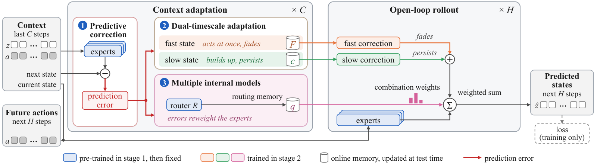
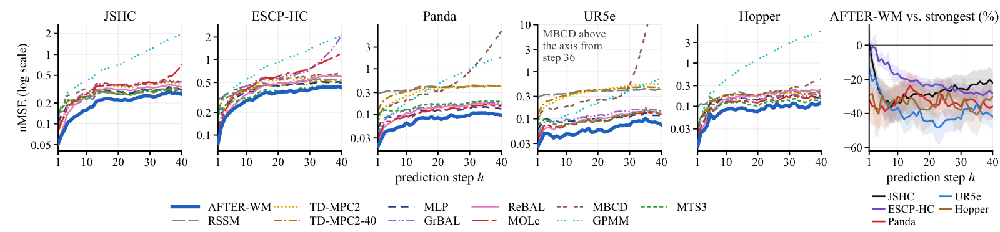
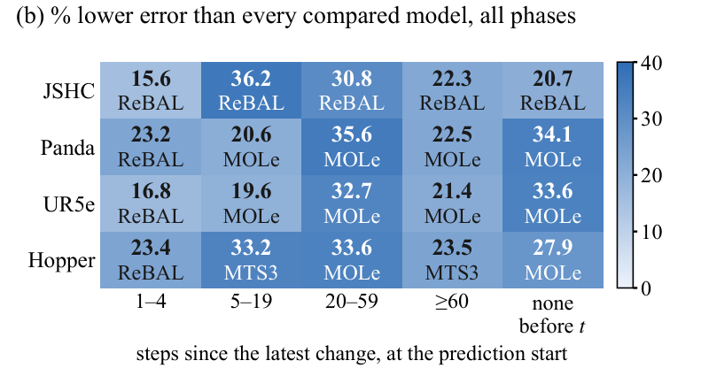
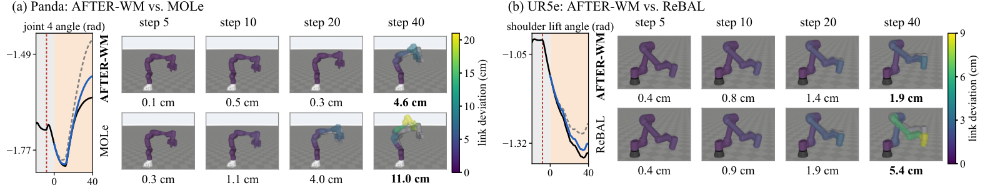
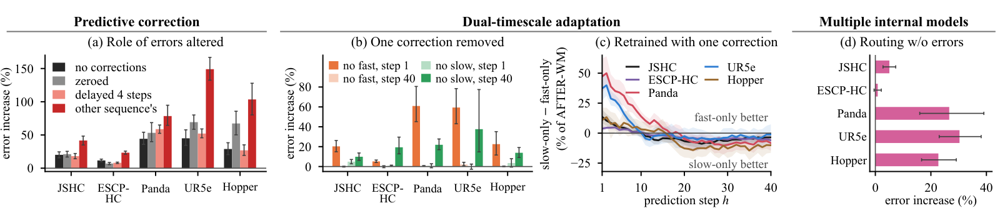
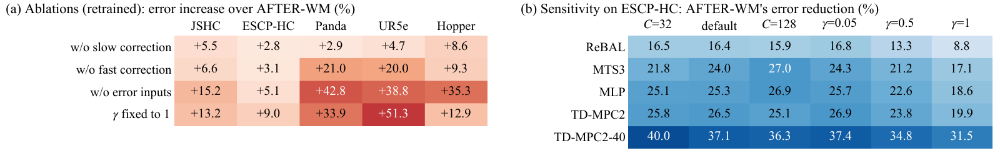

<div align="center">

# AFTER

### A World Model with Adaptive Fast–Slow Timescales<br>for Error-Driven Retention

**匿名作者**

**[English](README.md) | 简体中文**

**[快速上手](#快速上手)** · **[数据集](#数据集)** · **[主结果](#主结果)**

</div>

**AFTER-WM 是一个世界模型（Adaptive Fast–slow Timescales for Error-driven Retention）。** 受人脑具有多时间尺度适应的预测编码机制启发，它的预测误差驱动逐渐消退的快修正和持久的慢修正，同时动态调整各预训练专家的组合权重而不改动专家本身，以克服快速性、稳定性与持久性之间的权衡。

本仓库是论文 **AFTER: A World Model with Adaptive Fast–Slow Timescales for Error-Driven Retention** 的配套仓库，包含 AFTER-WM 的代码（`afterwm/`）、十个对比模型（`baselines/`）、所有模型共用的训练和测试流程（`pipeline/`）、数据集生成器和六个数据集（`datasets/`、`data/`）、统计与画图代码（`afterwm_stats/`、`figures/`）、已保存的测试输出（`outputs/`）以及各个入口脚本（`experiments/`）。“论文内容与脚本对照”一节的表格列出可复现的每张图表和对应的脚本。本文件是 `README.md` 的中文版。

## 概览

世界模型预测机器人的状态如何随动作变化，供规划和控制使用。在机器人与具身智能领域，世界模型面临的一个核心挑战，是在交互过程中适应机器人动力学突发、持续且事先未知的变化。例如，机械臂抓取未知负载的物体时，机器人动力学会发生突发变化。若世界模型不能适应，它的预测误差会在开环预测中不断累积，最终误导机器人的动作。

然而，现有世界模型难以同时满足动力学适应的三个关键要求：

- **快速性**，即迅速响应突发变化，抑制预测误差累积。
- **稳定性**，即区分持续变化与瞬时扰动，避免错误的更新。
- **持久性**，即在没有新观测时保持已适应的动力学，使后段的预测不退回旧的动力学。

要同时满足这三个要求很难。适应反应越快，就越容易被瞬时扰动误导，而消退得足够快、能丢掉瞬时扰动的适应，又无法持久保持。

AFTER-WM 的三个设计，即预测校正、双时间尺度适应和多重内部模型，都由同一组预测误差驱动，共同旨在实现兼具快速性、稳定性和持久性的动力学适应：

1. **预测校正**主要服务于快速性。一组预训练的动力学模型充当内部模型，称为专家，它们的一步预测误差在每个观测到的步上更新在线记忆，无需梯度。
2. **双时间尺度适应**主要服务于稳定性和持久性。它的快修正立即起作用并逐渐消退，而慢修正逐步积累并持久保持。
3. **多重内部模型**主要服务于持久性。预测误差通过路由记忆调整组合权重，从不改动专家本身。



*AFTER-WM 的结构（论文图 2）。图中左边是输入，右边是预测出的状态。上下文适应部分对每个上下文步各做一次（×C）。其中模块一算出各专家的预测误差（红色箭头），这些误差再更新模块二和模块三中的在线记忆（圆柱）。开环预测部分对每个预测步各做一次（×H），各专家的预测加上橙色的快修正和绿色的慢修正，再按粉色的路由记忆给出的组合权重求和。蓝色模块先预训练，之后固定不变，橙色、绿色和粉色模块在第二阶段训练。虚线框中的损失只用于训练。*

测试时变化的只有在线记忆，即路由记忆，以及每个专家的快状态和慢状态。这些记忆由上下文算出，不是训练得到的，因此适应变化时不需要梯度更新。开环预测的预测期内没有新的观测，所以路由记忆和慢状态保持固定，快状态只逐渐消退，组合权重也只算一次。

**任务与指标。** 所有模型都使用同样的 C = 64 步的上下文和 H = 40 步（2 秒）的预测期。给定相同的上下文，以及数据中记录的、要预测的 40 步的动作，每个模型都只预测这 40 步的状态。误差在状态上计算，而不是在图像上。逐步误差（nMSE）是某一个预测步上的均方误差，其中每个状态维都按训练集做了标准化。主指标是多步平均误差，它先取第 1 步到第 n 步逐步误差的平均，再对 n ∈ {1, 5, 10, 20, 40} 取平均，这样短期和长期预测都计算在内。第 40 步误差是最后一步的逐步误差。一个测试样本（代码和英文文档里叫 query）就是 64 步上下文加上其后 40 步的动作和状态。

## 快速上手

快速上手只需要 CPU，不需要 GPU，不需要模型文件，也不需要另外下载任何东西：六个数据集和已保存的测试输出都在仓库里。

1. **取得仓库。** 下载本仓库，解压后在它的文件夹里打开终端。

2. **安装画图环境**（Python 3.11；只有 numpy、matplotlib 和 Pillow）。

   ```
   python3.11 -m venv venv-figures && venv-figures/bin/pip install -r environment/requirements-figures.txt
   ```

3. **检查数据并重新算出结果。**

   ```
   venv-figures/bin/python datasets/check_data.py --data data
   PYTHON=venv-figures/bin/python bash experiments/all_from_outputs.sh
   venv-figures/bin/python scripts/verify_release.py --results results
   ```

第一条命令把 `data/` 里的每个数组与记录的校验值比对。第二条命令读取 `outputs/`，把结果写到 `results/`；大约需要 30 秒，最后一行输出 `done: results written to results` 就表示成功。第三条命令把数据文件、已保存的测试输出、表 1 的数值和正文中的九个数字与记录的数值比对，输出 `"passed": true` 表示全部一致。仓库每次更新时，`.github/workflows/reproduce.yml` 都会自动把这三条命令运行一遍。

| 写出的文件 | 内容 |
|---|---|
| `results/tables/table1.tex` | 表 1 |
| `results/tables/table2.tex` | 表 2 |
| `results/figures/` | 图 1b、图 3、图 4（机械臂姿态）、图 6 和图 7，PDF 和 PNG 各一份，另有画图用的数值（JSON） |
| `results/paper_numbers.json` | 本仓库能复现的正文数字，逐项列出（见 `docs/RESULTS_MAP.md`） |
| 其他 `results/*.json` 文件 | 逐步误差、变化阶段、没有变化的测试样本、对三个设计的检验、线性探针、敏感性和控制 |

想单独重算某一项，运行 `experiments/` 里对应的脚本（见“论文内容与脚本对照”一节的表格）。

## 主结果

本节的数字都由 `experiments/all_from_outputs.sh` 从已保存的测试输出重新算出（见“快速上手”）。

### 五个仿真数据集上的主结果（表 1）

可靠的规划需要多步都准的预测，因此我们在五个仿真数据集上比较所有模型的多步平均误差和第 40 步误差。下表是多步平均误差，数值为 5 个种子的均值 ± 标准差。在每个数据集上，多步平均误差最低的对比模型称为最强的对比模型。它是 ReBAL 或 MOLe，两者都是在线自适应模型。

| 数据集 | AFTER-WM | 最强的对比模型 | AFTER-WM 与最强的对比模型相比 |
|---|---|---|---|
| JSHC | **0.124 ± 0.001** | ReBAL：0.166 ± 0.007 | 低 25.7%，在全部 5 个种子上都更低 |
| ESCP-HC | **0.208 ± 0.003** | ReBAL：0.249 ± 0.004 | 低 16.4%，在全部 5 个种子上都更低 |
| Panda | **0.0473 ± 0.0007** | MOLe：0.0711 ± 0.0013 | 低 33.5%，在全部 5 个种子上都更低 |
| UR5e | **0.0435 ± 0.0014** | ReBAL：0.0641 ± 0.0035 | 低 32.1%，在全部 5 个种子上都更低 |
| Hopper | **0.0499 ± 0.0027** | MOLe：0.0752 ± 0.0024 | 低 33.7%，在全部 5 个种子上都更低 |

在全部五个数据集上，AFTER-WM 的两种误差都最低。它的多步平均误差在 5 个种子上都低于每个对比模型，全部 50 个差值的 95% 区间也都在 0 以下。它比最强的对比模型低 16.4%–33.7%。可见在仿真数据上，AFTER-WM 的多步预测最准确。

<details>
<summary><b>全部十一个模型：多步平均误差</b>（点击展开）</summary>

| 模型 | JSHC | ESCP-HC | Panda | UR5e | Hopper |
|---|---|---|---|---|---|
| DreamerV3-style RSSM | 0.197 ± 0.003 | 0.372 ± 0.006 | 0.329 ± 0.016 | 0.331 ± 0.011 | 0.145 ± 0.003 |
| TD-MPC2 | 0.192 ± 0.002 | 0.284 ± 0.008 | 0.189 ± 0.013 | 0.226 ± 0.014 | 0.102 ± 0.004 |
| TD-MPC2-40 | 0.212 ± 0.002 | 0.332 ± 0.002 | 0.244 ± 0.007 | 0.253 ± 0.010 | 0.111 ± 0.002 |
| MLP | 0.195 ± 0.001 | 0.279 ± 0.002 | 0.0841 ± 0.0024 | 0.0846 ± 0.0035 | 0.0953 ± 0.0011 |
| GrBAL | 0.210 ± 0.006 | 0.352 ± 0.087 | 0.0889 ± 0.0040 | 0.0836 ± 0.0034 | 0.0817 ± 0.0040 |
| ReBAL | 0.166 ± 0.007 | 0.249 ± 0.004 | 0.0728 ± 0.0017 | 0.0641 ± 0.0035 | 0.0867 ± 0.0126 |
| MOLe | 0.204 ± 0.010 | 0.320 ± 0.021 | 0.0711 ± 0.0013 | 0.0665 ± 0.0012 | 0.0752 ± 0.0024 |
| MBCD | 0.245 ± 0.006 | 0.365 ± 0.024 | 0.318 ± 0.412 | 1.951 ± 3.957 | 0.111 ± 0.021 |
| GPMM | 0.395 ± 0.077 | 0.496 ± 0.021 | 0.216 ± 0.103 | 0.124 ± 0.071 | 0.535 ± 0.396 |
| MTS3 | 0.208 ± 0.001 | 0.274 ± 0.004 | 0.126 ± 0.003 | 0.0861 ± 0.0031 | 0.0796 ± 0.0020 |
| **AFTER-WM** | **0.124 ± 0.001** | **0.208 ± 0.003** | **0.0473 ± 0.0007** | **0.0435 ± 0.0014** | **0.0499 ± 0.0027** |

</details>

<details>
<summary><b>全部十一个模型：第 40 步误差</b>（点击展开）</summary>

| 模型 | JSHC | ESCP-HC | Panda | UR5e | Hopper |
|---|---|---|---|---|---|
| DreamerV3-style RSSM | 0.311 ± 0.004 | 0.532 ± 0.009 | 0.404 ± 0.022 | 0.418 ± 0.013 | 0.224 ± 0.009 |
| TD-MPC2 | 0.370 ± 0.012 | 0.599 ± 0.033 | 0.411 ± 0.026 | 0.547 ± 0.064 | 0.204 ± 0.010 |
| TD-MPC2-40 | 0.279 ± 0.009 | 0.499 ± 0.012 | 0.409 ± 0.010 | 0.450 ± 0.022 | 0.219 ± 0.013 |
| MLP | 0.306 ± 0.009 | 0.486 ± 0.009 | 0.130 ± 0.007 | 0.116 ± 0.003 | 0.177 ± 0.004 |
| GrBAL | 0.402 ± 0.021 | 2.119 ± 3.354 | 0.176 ± 0.009 | 0.145 ± 0.006 | 0.203 ± 0.032 |
| ReBAL | 0.341 ± 0.008 | 0.596 ± 0.029 | 0.162 ± 0.011 | 0.130 ± 0.018 | 0.247 ± 0.029 |
| MOLe | 0.726 ± 0.723 | 1.222 ± 0.607 | 0.149 ± 0.007 | 0.123 ± 0.005 | 0.178 ± 0.012 |
| MBCD | 0.388 ± 0.022 | 0.641 ± 0.034 | 6.801 ± 14.710 | 172.477 ± 384.954 | 0.434 ± 0.480 |
| GPMM | 1.944 ± 0.928 | 2.065 ± 0.153 | 1.815 ± 1.153 | 0.717 ± 0.945 | 5.595 ± 4.130 |
| MTS3 | 0.290 ± 0.004 | 0.441 ± 0.002 | 0.190 ± 0.011 | 0.133 ± 0.006 | 0.157 ± 0.004 |
| **AFTER-WM** | **0.266 ± 0.008** | **0.428 ± 0.008** | **0.0956 ± 0.0021** | **0.0753 ± 0.0037** | **0.124 ± 0.003** |

</details>

在 Panda 和 UR5e 上，MBCD 有一个种子的预测发散。

### 逐步误差（图 3）



*论文图 3。五个仿真数据集上所有模型的逐步误差（左），以及 AFTER-WM 与最强的对比模型的比较（右）。*

平均值可能掩盖个别步上的不足，而适应需要在整个预测期持久保持，因此我们还比较 40 个预测步中每一步的误差。AFTER-WM 是粗蓝线，在每个仿真数据集上，它从第 2 步起每一步的误差都最低。右图以百分比表示 AFTER-WM 的逐步误差与最强的对比模型相差多少，每条彩色线对应一个数据集。在 0 以下，AFTER-WM 更好。从第 4 步起，所有区间都在 0 以下，到第 40 步，它的误差低 21.9%–41.9%。可见它在最后一步仍然领先。

### 按变化阶段（图 1b）



*论文图 1b。AFTER-WM 的误差比最接近的对比模型低多少。*

平均值看不出快速性、稳定性和持久性。因此我们按最近一次变化离预测起点有多久，把测试样本分成五个阶段，在每个阶段比较所有模型。每行是一个数据集，每列是一个阶段。每格的粗体数字是 AFTER-WM 的多步平均误差比最接近的对比模型低多少，下面写的是这个模型。蓝色越深，差距越大。所有格子都是正数，所以 AFTER-WM 在每个阶段都胜过全部十个对比模型。ESCP-HC 的阶段划分不同，没有画出，但在它上面同样如此。即使在变化后 1–4 步，AFTER-WM 也至少低 15.6%。在上下文和预测期内都没有变化的样本上，它至少低 6.6%。如果这些样本中有瞬时扰动，就能检验适应是否具备稳定性，这时在 Panda、UR5e 和 Hopper 上，它至少低 28.1%。因此在仿真数据上，无论变化刚刚发生、正在持续还是不存在，AFTER-WM 都最准确。

### 机械臂上的例子（图 4）



*论文图 4。AFTER-WM 和最强的对比模型预测的关节角，画成机械臂姿态，从变化发生 8 步后开始预测。*

Panda 机械臂抓起约 1.4 kg 的负载，关节摩擦也随之变化，UR5e 则放下负载，摩擦和电机强度恢复正常。右边的图画出第 5、10、20、40 步的姿态，上排是 AFTER-WM，下排是对比模型，灰色的是真实姿态。预测的每个连杆按它的 link deviation（离真实位置的距离）着色，单位是厘米。图下的数字是各连杆距离的平均值，第 40 步的数字加粗。这一步 AFTER-WM 在 Panda 上偏差 4.6 cm，在 UR5e 上偏差 1.9 cm，都不到 MOLe 的 11.0 cm 和 ReBAL 的 5.4 cm 的一半。

### 泛化与控制（表 2）

其他检验，AFTER-WM 胜过的对比模型数和最小优势。

| 设置 | 胜过的对比模型数 | 最小优势（最接近的对比模型） |
|---|---|---|
| 超出训练范围的变化（ESCP-HC） | 10/10 | 5.9%（ReBAL） |
| 没有变化（5 个数据集） | 10/10 | 6.6%（ReBAL） |
| 真实飞行数据（ALFA） | 10/10 | 13.1%（MOLe） |
| 控制（JSHC） | 10/10 | +13.8（MOLe） |

- **超出训练范围的变化。** 部署时的变化可能超出训练时见过的范围。在 ESCP-HC 上，AFTER-WM 胜过全部十个对比模型，多步平均误差至少低 5.9%。
- **真实飞行数据。** 仿真可能漏掉一些真实的变化，因此我们也在 ALFA 上用相同的设置测试，所有模型共用 4 个随机种子。在 ALFA 上，AFTER-WM 的多步平均误差比每个对比模型至少低 13.1%，而且在 4 个种子上都更低。
- **控制。** 世界模型最终用于规划，因此我们在 JSHC 上沿用 GrBAL 的关节失效任务，检验精度更高能否带来更高的回报，即总奖励。实验用 5 个种子和 48 个测试回合。所有模型都接入同一个基于交叉熵方法的规划器，回报的差别因而来自世界模型本身。预测最准的 AFTER-WM 平均回报也最高，为 93.1，比第二名 MOLe 高 13.8。

### 三个设计各自的作用（图 6）



*论文图 6。对三个设计的检验。（a）（b）（d）是测试时的改动，（c）是重新训练的模型。UR5e 上（b）（d）用 4 个种子。*

- **预测校正。** 这一设计意味着 AFTER-WM 依赖当前序列的预测误差。测试时，我们去掉两种修正，或者把预测误差置零、延迟 4 步，或者换成另一个序列的。四种改动在每个数据集上都使多步平均误差上升，最后一种上升最多，为 23.3%–149.0%。可见起作用的是误差的具体内容，而不只是它的统计规律。
- **双时间尺度适应。** 这一设计意味着快修正主要服务前几步，慢修正主要服务后面的步。去掉快修正后，第 1 步误差上升 5.2%–60.9%。去掉慢修正后，第 40 步误差上升 9.9%–37.6%。而另一步上的误差，变化都不超过 4.9%。
- **多重内部模型。** 这一设计意味着，专家本身保持不变，只按它们的预测误差重新分配权重，就能改善预测。测试时不再让预测误差更新路由记忆后，多步平均误差的上升幅度除 ESCP-HC 只有 0.9% 外，都在 5.1%–30.3% 之间。可见按误差重新分配专家的权重是有帮助的。

### 消融与超参数敏感性（图 7）



*论文图 7。多步平均误差。（a）消融，在约 0.70M 参数下重新训练。（b）ESCP-HC 上对 C 和 γ 的敏感性。*

- **消融。** 为检验起作用的是 AFTER-WM 的各个部件，而不只是参数量，我们每次去掉一个部件，在约 0.70M 参数下重新训练。去掉任何一个部件，都会使每个数据集上的误差上升，幅度为 2.8%–51.3%。可见在这些数据集上，快、慢两种修正、误差输入和较平均的权重都有帮助。
- **超参数敏感性。** 在 ESCP-HC 上，改动了设置的 25 格中，AFTER-WM 在 5 个种子上都更好，误差低 8.8%–40.0%。所以在 ESCP-HC 上，AFTER-WM 在所测的每种设置下都领先。

## 数据集

我们使用六个数据集，其中五个用 MuJoCo 仿真生成，一个是真实飞行数据。沿用已有设定的两个数据集来自已有工作。关节失效切换 HalfCheetah（JSHC）与 GrBAL 和 MBCD 一样，每 100 步让一个随机的腿部关节失去动力。ESCP-HC 与 ESCP 一样，每 100 步把重力、关节阻尼和躯干质量各乘以一个新的随机倍数。新构建的三个数据集基于标准机器人模型，加入了机械臂和更多种类的变化。在 Panda 和 UR5e 两台机械臂上，变化的是末端负载、关节摩擦和电机强度，在 Hopper 上则是躯干质量、地面摩擦和电机强度。变化会发生一次或多次，可能恢复原状或缓慢漂移，其间还穿插着脉冲、撞击这类瞬时扰动。真实数据来自公开数据集 ALFA，是固定翼无人机在飞行中发生发动机或舵面故障的记录。所有数据文件都在 `data/` 里。

| 数据集 | 变化的是什么 | 状态维数 / 动作维数 | 各划分的序列数 | 数据文件夹大小（MB） | 说明卡 |
|---|---|---|---|---|---|
| JSHC | 每 100 步让一个随机的腿部关节失去动力 | 17 / 6 | 288 / 144 / 144 / 144 | 14.0 | [jshc.md](datasets/cards/jshc.md) |
| ESCP-HC | 每 100 步把重力、关节阻尼和躯干质量各乘以一个新的随机倍数 | 17 / 6 | 288 / 144 / 144 / 144 | 24.2 | [escphc.md](datasets/cards/escphc.md) |
| Panda | 机械臂的末端负载、关节摩擦和电机强度 | 14 / 7 | 288 / 144 / 144 / 144 | 8.5 | [panda.md](datasets/cards/panda.md) |
| UR5e | 机械臂的末端负载、关节摩擦和电机强度 | 12 / 6 | 288 / 144 / 144 / 144 | 7.2 | [ur5e.md](datasets/cards/ur5e.md) |
| Hopper | 躯干质量、地面摩擦和电机强度 | 11 / 3 | 288 / 144 / 144 / 144 | 6.4 | [hopper.md](datasets/cards/hopper.md) |
| ALFA | 真实的固定翼无人机飞行，带发动机或舵面故障 | 12 / 3 | 240 / 86 / 100 / 122 | 10.6 | [alfa.md](datasets/cards/alfa.md) |

四个划分依次是 TRAIN / VAL / TEST / TEST_B（论文中的 TE-B）；论文把 TEST 和 TEST_B 合在一起作为测试集。大小是文件夹里四个文件之和，单位是 1,000,000 字节。

- **格式。** 每个文件是一个 NumPy `.npz` 文件。每个序列有 301 个状态和 300 个转移，每步 0.05 秒。数组 `obs` 是状态，`act` 是动作，都是 float32。物理参数和变化标签只用于分析，不是任何模型的输入。
- **另有两个文件夹**只用于评测：`data/escphc_beyond/`（ESCP-HC 上超出训练范围的测试文件）和 `data/control_episodes/`（控制任务的初始条件）。
- **文档。** 数据说明书是 [data/README.md](data/README.md)（组成、采集、划分、标签、许可证、校验值）。每个数据集在 `datasets/cards/` 里有一张说明卡。总览和命令见 [docs/DATASETS.md](docs/DATASETS.md)。
- **重新生成。** 五个仿真数据集的生成器和 ALFA 的处理脚本都在 `datasets/` 里；命令和固定版本的环境见 `docs/DATASETS.md`。

读取一个文件并切出一个测试样本的例子，见英文版 `README.md` 的同一节或 `data/README.md`。

## 训练与评测

### 对比模型

我们把 AFTER-WM 与三类中的十个模型比较。通用模型有 DreamerV3 的循环状态空间模型（RSSM）、TD-MPC2、用 40 步损失训练的 TD-MPC2-40 和一个 MLP。在线自适应模型有 GrBAL、ReBAL、MOLe、MBCD 和 GPMM，多时间尺度模型是 MTS3。包括 AFTER-WM 在内，所有神经网络模型的参数量都约为 0.70M（GPMM 是非参数模型），因此差别不能归因于模型大小。所有模型都使用同一套训练和测试流程、同样的数据划分、C = 64 步的上下文和 H = 40 步（2 秒）的预测期。所有设置都不靠测试数据来选，AFTER-WM 用 K = 3 个专家。

| 类别 | 模型 | 代码 |
|---|---|---|
| 通用模型 | DreamerV3 的 RSSM | `baselines/rssm.py` |
| 通用模型 | TD-MPC2 | `baselines/tdmpc2.py` |
| 通用模型 | TD-MPC2-40（用 40 步损失训练） | `baselines/tdmpc2_h40.py` |
| 通用模型 | MLP | `baselines/mlp.py` |
| 在线自适应模型 | GrBAL | `baselines/grbal.py` |
| 在线自适应模型 | ReBAL | `baselines/rebal.py` |
| 在线自适应模型 | MOLe | `baselines/mole.py` |
| 在线自适应模型 | MBCD | `baselines/mbcd.py` |
| 在线自适应模型 | GPMM | `baselines/gpmm.py` |
| 多时间尺度模型 | MTS3 | `baselines/mts3.py` |

各原始方法的来源和许可证列在 `THIRD_PARTY_NOTICES.md`。

### 训练 AFTER-WM

AFTER-WM 分两个阶段训练。

- **第一阶段预训练底座。** 专家和路由网络在训练集的短片段上一起训练。每个专家得到的训练信号取决于它预测得准不准，因此不需要任何关于变化的标签。随后，第二阶段只在冻结的底座之上添加网络。
- **第二阶段训练读写记忆的网络。** 这些网络按测试时的运行方式训练。每个样本都先重置记忆，读入 C 步上下文，再开环预测 H 步。梯度沿整段上下文反向传播，使模型学会从误差中读出变化。损失只在预测期上计算。

两个阶段、验证集上的选择步骤、消融、十个对比模型和敏感性设置的命令都在 `docs/REPRODUCE.md`。每个模型在每个数据集上的配置在 `configs/models/`，记录下来的选择结果在 `configs/selection/`。

### 三种运行方式

每个入口脚本都接受三种运行方式之一。

- `--from-outputs`（默认，只需 CPU，`experiments/all_from_outputs.sh` 大约 30 秒）。从已保存的测试输出重新算出“论文内容与脚本对照”表中列出的结果。对这些结果来说，已保存的测试输出就是基准。
- `--from-checkpoints`（需要 GPU）。用于你自己训练并保留下来的模型。把这些训练结果放到一个根目录下（`AFTERWM_RUNS_ROOT`），运行 `bash experiments/regenerate_outputs.sh`；`outputs/examples/` 不由这个脚本重建，做法见 `docs/REPRODUCE.md`。然后把 `AFTERWM_OUTPUTS` 设为重新生成的文件夹，再运行入口脚本。
- `--from-scratch`（需要 GPU）。先按 `docs/REPRODUCE.md` 训练全部模型（第一阶段、选择步骤、所有模型和敏感性设置），再按 `--from-checkpoints` 继续。

用 `--from-checkpoints` 或 `--from-scratch` 时，入口脚本会先提示所需的 GPU 步骤，按 `docs/REPRODUCE.md` 完成后再运行。

## 论文内容与脚本对照

| 论文内容 | 脚本 | 写出什么 |
|---|---|---|
| 表 1 | `experiments/table1_main.sh` | 数字与论文表 1 相同 |
| 表 2 | `experiments/table2_beyond_range.sh`、`table2_no_change.sh`、`table2_alfa.sh`、`table2_control.sh` | 表 2 的四行；表格本身由 `experiments/all_from_outputs.sh` 写出 |
| 图 1b | `experiments/fig1b_change_phases.sh` | 按变化阶段的误差降低幅度 |
| 图 3 | `experiments/fig3_per_step.sh` | 逐步误差 |
| 图 4 | `experiments/fig4_robot_arm_examples.sh` | 第 5、10、20、40 步的机械臂姿态和各连杆的距离 |
| 图 6 | `experiments/fig6a_errors_altered.sh`、`fig6b_one_correction_removed.sh`、`fig6c_retrained_one_correction.sh`（画出整张图）、`fig6d_routing_without_errors.sh` | 对三个设计的检验 |
| 图 7 | `experiments/fig7a_ablations.sh`、`fig7b_sensitivity.sh`（画出整张图） | 消融与超参数敏感性 |
| 4.2、4.4、4.5、4.6 节正文中的数字，以及摘要中的 16%–34% | `experiments/all_from_outputs.sh` → `results/paper_numbers.json` | 没有变化和只有瞬时扰动的测试样本：`experiments/sec42_windows.sh` |
| 补充材料正文中由同一批已保存输出得到的数字（逐步比较、变化阶段、测试时的改动、按阶段去掉一种修正、只保留一种修正的重训模型、线性探针、控制） | `experiments/all_from_outputs.sh`、`experiments/supp_e3_probes.sh` | 逐项列在 `docs/RESULTS_MAP.md` |

## 论文与代码的对应

论文各公式和各节对应的文件、函数或类，见英文版 `README.md` 的 “Where things are in the code” 一节。方法在 `afterwm/`：第一阶段是 `afterwm/stage1.py`，完整模型是 `afterwm/model.py` 和 `afterwm/core.py`。

## 安装、算力、目录结构、说明

这几节见英文版 `README.md`（Install、Compute、Repository layout、Notes）。要点如下：

- 需要 Python 3.11；训练、测试和数据集生成是在 Linux 上运行的。三个环境的固定版本列在 `environment/` 里。
- `--from-outputs` 只需 CPU，大约 30 秒。已保存输出背后的 499 次训练，记录的训练时间合计约 660 GPU 小时。
- 对上表列出的结果，已保存的测试输出就是基准；在另一种型号的 GPU 上重新计算，数值可能有细微差别。
- ALFA 用 4 个种子；UR5e 在测试时去掉一种修正、路由记忆不再按误差更新和线性探针这几项检验中用 4 个种子，其余都用 5 个种子。
- 有些标识符是固定的字符串，会进入随机种子或固定的校验值，不要改动，列在 `docs/FIXED_IDENTIFIERS.md`。

## 许可证

代码：MIT（`LICENSE`）。数据和已保存的测试输出：CC BY 4.0（`DATA_LICENSE.md`）；ALFA 的序列由 ALFA 数据集处理得到，保留它的 CC BY 4.0 许可证。使用 ALFA 的序列时，请引用 `DATA_LICENSE.md` 中列出的两篇 ALFA 论文。第三方代码和数据：`THIRD_PARTY_NOTICES.md`。`docs/assets/` 里的图片是论文中的图，仅供参考，不在本仓库的 MIT 或 CC BY 4.0 授权范围内。
